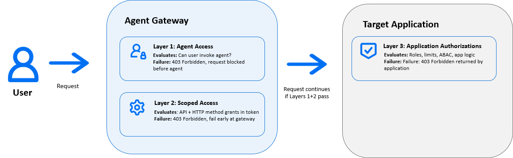
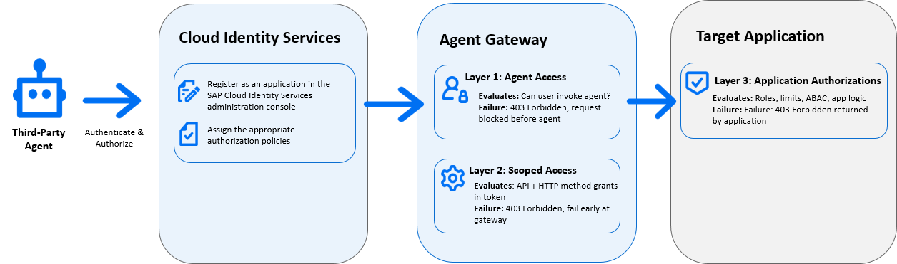

<!-- loioa51e764e70af487082e3f1dc880dee92 -->

# Managing Agents

Agent identities automatically appear in SAP Cloud Identity Services after you deploy agents. You can use SAP Cloud Identity Services to review and manage access to these agents.

> ### Caution:  
> This page is still work in progress. This page contains information about product features that are part of an SAP Early Adopter Care \(EAC\) program. Products or features that are part of an EAC program are not available to users outside of this program.

When you deploy an agent in your SAP landscape, the system automatically registers it in SAP Cloud Identity Services. The agent appears in the *Users & Authorizations* area of the administration console. Assistants, higher-level AI entities that orchestrate one or more agents, also appear in this area and are managed in the same way. From there, you can control which users or groups can invoke the agent. You can't create or delete agent or assistant registrations manually. Nor can you change the agent's authorized API scope. The agent's authorizations are defined by its developer and are read-only for administrators.

Assistants and the agents they invoke are separate registered identities. If an assistant invokes one or more agents, assigning a user to the assistant does not automatically grant them access to those agents. You must assign the user to the assistant and to each agent it invokes separately. If any assignment is missing, the user receives an authorization error when the assistant attempts to invoke the unassigned agent, even if the user has access to all the other entities. When planning access for a user, identify the full chain of entities they need to reach and assign them to each one.

Controlling access to an agent has direct downstream consequences. When you assign a user or group to an agent, you grant those users the right to invoke it. After invocation, the agent acts within the bounds of both its own scoped authorization policies and the invoking user's authorizations in the connected back-end systems. The agent can only call the APIs it was designed to use, and those calls are further limited by what the user is permitted to do in the target application. A user can't use an agent to perform an action that their authorizations wouldn't otherwise allow, and the agent can't access APIs beyond its defined scope regardless of the user's permissions. Assigning access to an agent is a security decision. It determines not only who can use the feature, but also who can trigger actions in downstream systems through it.

## Agent Authorization Policies

Three layers of authorization govern access to and through an agent. The system enforces each layer at a different point in the request path.

The layers are:

1.  **Agent access**: whether the requesting user has permission to invoke the agent at all. The system performs this check at the agent gateway on every request. The system automatically generates the policy when you deploy the agent, based on its metadata. The policy appears under the *Authorization Policies* tab of the agent's application entry in the administration console. You can restrict or extend this policy by deciding which users and groups can use the agent.

2.  **Scoped access**: whether the agent has permission to call a specific API with a specific HTTP method. The system also enforces this check at the agent gateway, based on grant permissions defined in the agent's authorization token. This check ensures the agent is limited to the API surface it was designed to use, regardless of the invoking user's broader permissions.

3.  **Application authorizations**: whether the specific action is permitted by the target application's own authorization logic, for example, ABAP role checks, instance limits, or attribute-based controls in SAP S/4HANA. The target application itself performs this check and returns a 403 response if the action is not permitted. This layer is not configurable in SAP Cloud Identity Services.

The system automatically generates baseline policies for layers one and two from the agent's metadata at deployment time. You can review and adjust these policies in the *Authorization Policies* tab of the agent's application entry. The target application always controls layer three.

  
  
**Three Layer Authorization**

## Agent Identity for Third-Party Tools

Third-party AI tools \(external agents not built or deployed by SAP\) can also access SAP systems through the agent gateway. To connect a third-party agent, register it as an application in the SAP Cloud Identity Services administration console and assign the appropriate authorization policies. The same three-layer access model applies. The agent must be permitted at the gateway, must have scoped access to the APIs it requires, and its actions remain subject to the target application's own authorization checks.

For more information about registering third-party agents, see [Setting Up Integration with Third-Party Agents](https://help.sap.com/docs/ariba/setting-up-integration-with-third-party-agents/setting-up-integration-with-third-party-agents).

After you register a third-party agent, it authenticates to the agent gateway using the credentials configured in its application entry in SAP Cloud Identity Services. You can then assign access policies to control which users can invoke the third-party agent and which API operations it is authorized to perform.

  
  
**Third-Party Agent Authorization Architecture**

**Related Information**  

[Configuring Applications](configuring-applications-61ad3b0.md "This section describes how you can configure the user authentication, access to an application, and use a branding style in accordance with your company requirements. It also explains the trust configuration between Identity Authentication and a service provider or client (relying party).")

[Configuring Tenant Settings](configuring-tenant-settings-d4d6fdc.md "Initially, the tenants are configured to use default settings. This section describes how you as a tenant administrator can make custom tenant configurations.")

[Configuring Password Policies](configuring-password-policies-12b3395.md "Passwords for the authentication of users are subject to certain rules. These rules are defined in the password policy. Identity Authentication provides you with two predefined password policies, in addition to which you can create and configure up to three custom password policies.")

[Configuring Privacy Policies](configuring-privacy-policies-ed48466.md "You can configure a custom privacy policy document by creating a new document, adding and editing its language versions, and defining the document for an application.")

[Configuring Authorization Policies](configuring-authorization-policies-982ac5f.md "Authorization Management enables SAP Cloud Identity Services administrators to use authorization policies, customize them, and assign them to users.")

[Configuring Terms of Use](configuring-terms-of-use-61d3a86.md "You can configure a custom terms of use document by creating a new document, adding and editing its language versions, and defining the document for an application.")

[Configuring Email Templates](configuring-email-templates-b2afbcd.md "Tenant administrators can use the default or a custom email template set for the application processes.")

[Managing Administrators](managing-administrators-786eea2.md "This section describes how, as a tenant administrator, you can list all administrators in the administration console for SAP Cloud Identity Services, add new administrators, and edit the administrator authorizations. You can also remove administrators.")

[Managing Technical Users](managing-technical-users-fd1a636.md "As a user with assigned special policy authorizations, you can manage the technical users in the administration console for SAP Cloud Identity Services.")

[Managing Users](managing-users-228428f.md "Tenant administrators can manage user accounts via the administration console for SAP Cloud Identity Services, and via APIs.")

[Managing Groups](managing-groups-ddd067c.md "Tenant administrators can create groups, and assign and unassign these groups to users via the administration console for SAP Cloud Identity Services.")

[Configuring Provisioning Systems](configuring-provisioning-systems-f149f76.md "Configure provisioning systems for synchronizing users and groups between business applications.")

[Configuring Real-Time Provisioning](configuring-real-time-provisioning-617dd4b.md "As a tenant administrator, you can configure real-time provisioning to immediately provision entities from source to target systems.")

[Configuring Social Identity Providers](configuring-social-identity-providers-17d400d.md "By configuring a social provider, users can log on to applications with their social media credentials by linking their accounts in Identity Authentication to the social media account.")

[Integrating with Existing Customer Landscape](integrating-with-existing-customer-landscape-cf29ea1.md "Identity Authentication can be integrated with already existing customer landscape and supports different types of delegated authentication.")

[Configuring External Authentication Providers](configuring-external-authentication-providers-4f02f94.md "Configure authentication providers in the administration console for SAP Cloud Identity Services to manage users from external providers.")

[Configuring OpenID Connect \(OIDC\)](configuring-openid-connect-oidc-a789c9c.md "You can use Identity Authentication for authentication in OpenID Connect (OIDC) protected applications.")

[Identity and Access Management for Joule](../identity-and-access-management-for-joule-050287e.md "Identity and access management architecture required for Joule, including the requirement for a single SAP Cloud Identity Services tenant, SAP-managed provisioning, and global user ID assignment. Understand this foundation before you implement Joule to ensure consistent authentication and authorization across all connected SAP applications.")

[Agents](../agents-12bef24.md "Agent identity represents AI and automation agents in SAP Cloud Identity Services. Agents can authenticate, receive authorization, and be managed like human users while retaining agent-specific capabilities and security controls.")

[Understanding AI Agents Across SAP](https://help.sap.com/docs/BusinessAIPlatform/668ca39775bc4d8996526b5ffc6e436f/2971789ed98c4abe8affab5dc329036e.html)

