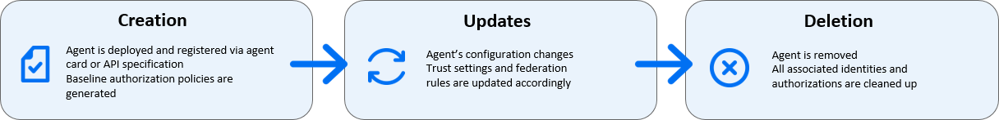

<!-- loio12bef241b1254430a867ee8b1e6e8c43 -->

# Agents

Agent identity represents AI and automation agents in SAP Cloud Identity Services. Agents can authenticate, receive authorization, and be managed like human users while retaining agent-specific capabilities and security controls.

> ### Caution:  
> This page is still work in progress. This page contains information about product features that are part of an SAP Early Adopter Care \(EAC\) program. Products or features that are part of an EAC program are not available to users outside of this program.

Agent identity combines multiple identity and access management \(IAM\) artifacts to provide comprehensive identity management for agents within SAP-centric environments.

When an agent is built in Joule Studio, the agent automatically appears as an agent identity in the SAP Cloud Identity Services administration console. This allows user administrators to review the agent's authorizations and define who can access the agent.

In development landscapes, Joule Studio includes a feature that automatically assign access, reducing the need to contact user administrators for routine development tasks.

From an identity and access management perspective, an agent is an application registered in SAP Cloud Identity Services. Each deployed agent appears in the *Agents* tile of the SAP Cloud Identity Services administration console, where you can review its authorization policies, inspect which APIs it can call, and control which users or groups can invoke it.

You can't create or delete agents through the administration console. The SAP platform automatically manages their lifecycle in response to deployment events. When an agent is deployed, SAP Cloud Identity Services registers it using the agent's own metadata \(its agent card or API specification\) and generates baseline authorization policies at that point. When the agent's configuration changes, the system updates trust settings and federation rules in a controlled, traceable manner. When an agent is removed, the system fully cleans up all associated identities and authorizations. To control which users or user groups can invoke an agent, use the *Agents* tile in the administration console.

  
  
**Lifecycle of an Agent**

SAP supports three categories of agents, each with a different level of administrator control:

-   LOB agents

    The system provisions LOB agents as part of SAP line-of-business solutions such as SAP S/4HANA or SAP SuccessFactors. You can adjust authorization rules for these agents but cannot modify the agent registration itself.

-   Custom agents

    Customers or partners build agents, for example using Joule Studio. The full range of configuration options is available, including trust settings and federation rules.

-   Third-party agents

    Third-party agents are external AI tools that connect to the SAP landscape through the agent gateway. They authenticate and authorize against SAP Cloud Identity Services in the same way as SAP-native agents.

The system manages authorizations in two phases for increased security:

-   Central Authorization in SAP Cloud Identity Services: Defines who can access an agent. This allows you to restrict agent access and provides visibility into the authorizations the agent has.

-   Principal Propagation: The agent works on behalf of the current user. Each application and back end checks the user's authorizations, ensuring that the agent can only access what the user has permission to access.

This two-phase approach ensures security even when workflows span multiple runtime types.

## Agents and Assistants

In Joule, an assistant is a higher-level AI entity that translates user intent into actions by coordinating agents. An assistant and each agent it invokes are separate registered identities in SAP Cloud Identity Services. Each requires its own user access assignment.

Access assignments are not inherited. If an assistant invokes one or more agents, assigning a user to the assistant does not automatically grant them access to those agents. You must assign the user to the assistant and to each agent it invokes separately. If any assignment is missing, the user receives an authorization error when the assistant attempts to invoke the unassigned agent, even if the user has access to all the other entities.

As an IAM administrator, plan your access assignments across the full chain of entities a user needs to reach, not just the entry point. For more information about how to perform these assignments, see [Enable Users to Access Agents](Operation-Guide/enable-users-to-access-agents-d87d8ad.md).

## What is an Agent Identity?

An agent identity in SAP Cloud Identity Services consists of the following components:

**Application Artifact** 

-   Represents a trusted client or system, such as S/4HANA or a dedicated agent application.
-   Includes metadata such as redirect URIs, keys, and trust configuration.
-   Establishes the technical connection for the SAP landscape.

**Agent User \(Technical User\)** 

-   Every agent has an associated technical user in the directory. This user is not a human user and can't authenticate through a browser \(front channel\). It authenticates only through back-channel methods such as client credentials, JWT bearer, and token exchange.
-   Agents always act on behalf of a human user. The agent user is used to assign authorization policies and user groups to the agent. These assignments define what the agent can do.
-   In a future release, agents will be able to act on their own behalf without a human user context.

**Dual Authorization Model** 

-   Agents act on behalf of a human user. For an action to succeed, both the agent and the user must have the necessary authorizations. The agent can access only the APIs defined by its authorization policies. The target application also applies the user's own authorization checks. An action succeeds only when both the agent's scope and the user's permissions allow it.

The system creates or deletes agents automatically when you subscribe or unsubscribe to an application or use an AI tool to create an agent.

## Core Use Cases

**Agent Acting for Present Human Users**

When a human user is present and delegates permissions:

-   The human-in-the-loop flow requests user approval.
-   The agent requests a user token through the token exchange flow.
-   The token includes user context for authorized actions.

> ### Planned:  
> Additional use cases are planned for future releases. These use cases include agents acting on your behalf when you're offline \(using stored delegation relationships\) and unattended agents acting on their own behalf without you in the loop. These use cases aren't currently supported.

### 

**Related Information**  

[Tenants](tenants-93160eb.md "A tenant refers to your (customer-specific) instance of SAP Cloud Identity Services. It's delivered to you as part of a bundle with an SAP cloud solution or as part of a self-service request in SAP BTP cockpit.")

[Bundles](bundles-25b65a4.md "A bundle is a group of preconfigured products and services which are sold together.")

[Applications](applications-404a11c.md "An application is associated with a consumer of Identity Authentication as an identity provider. This consumer could be for example an SAP cloud solution, a third-party application, SAP BTP subaccount, or the SAP Cloud Identity Services administration console.")

[Provisioning Systems](provisioning-systems-15da6af.md "Identity Provisioning provides connectors to various business applications for provisioning and deprovisioning of users and groups. These business applications are set up as provisioning systems in the administration console of SAP Cloud Identity Services.")

[Properties](properties-e92c1aa.md "Properties hold the configuration of a provisioning system.")

[Transformations](transformations-81f5204.md "Transformations help you transform user and group attributes from the data model of the source system to the data model of the target system.")

[Users](users-70e95d1.md "Users in SAP Cloud Identity Services fall into three categories: administrators, end users, and technical users.")

[Groups](groups-d93be69.md "SAP Cloud Identity Services offers groups to organize users based on common characteristics, authorization, or application. Use them to efficiently manage user access and permissions within your organization's SAP Cloud Identity Services environment.")

[Authorization Policies](authorization-policies-01ddefa.md "Authorization Management lets administrators control who can access what in business applications.")

[Cookies](cookies-e60fd04.md "")

[SAP-Managed SAP Cloud Identity](sap-managed-sap-cloud-identity-6039a38.md "SAP Cloud Identity Services support both SAP-managed and customer-managed integration models, depending on who is responsible for maintaining and operating the tenant, application and provisioning configurations.")

[Managing Agents](Operation-Guide/managing-agents-a51e764.md "Agent identities automatically appear in SAP Cloud Identity Services after you deploy agents. You can use SAP Cloud Identity Services to review and manage access to these agents.")

[Understanding AI Agents Across SAP](https://help.sap.com/docs/BusinessAIPlatform/668ca39775bc4d8996526b5ffc6e436f/2971789ed98c4abe8affab5dc329036e.html)

