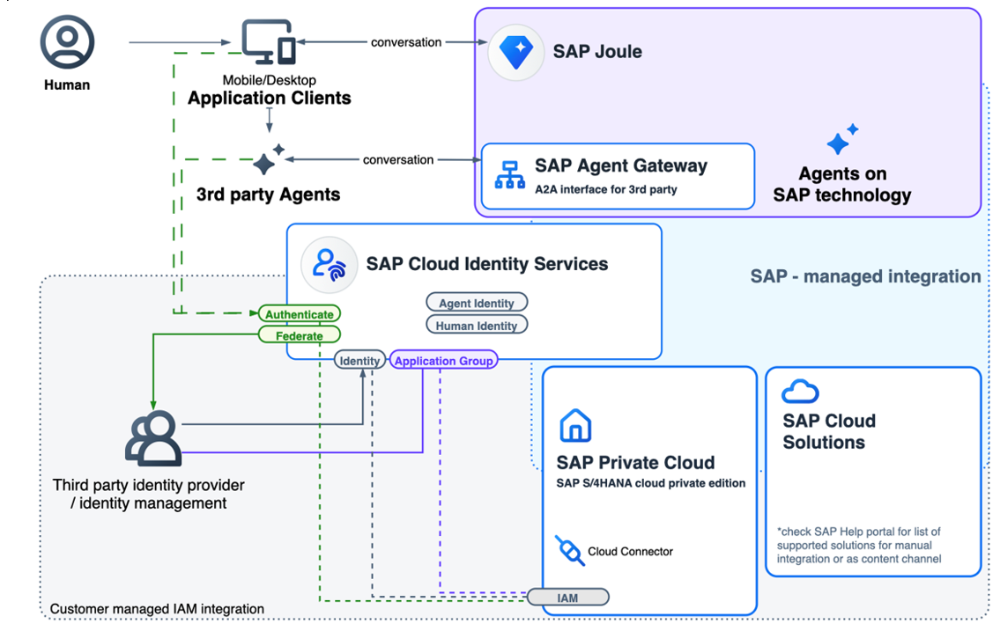

<!-- loio050287ee9ecc443dbae4c0939f69e680 -->

# Identity and Access Management for Joule

Identity and access management architecture required for Joule, including the requirement for a single SAP Cloud Identity Services tenant, SAP-managed provisioning, and global user ID assignment. Understand this foundation before you implement Joule to ensure consistent authentication and authorization across all connected SAP applications.

> ### Caution:  
> This page is still work in progress. This page contains information about product features that are part of an SAP Early Adopter Care \(EAC\) program. Products or features that are part of an EAC program are not available to users outside of this program.

Joule, SAP's AI assistant, works across multiple connected SAP applications. For Joule to deliver a consistent experience, all of those applications must authenticate users through a single SAP Cloud Identity Services tenant. This makes SAP Cloud Identity Services the central identity and access management \(IAM\) layer across your SAP landscape. It forms the foundation on which you build Joule and any AI agents you deploy alongside it.

This topic explains the IAM architecture required for Joule. It covers why we designed it this way, what you need to put in place before you activate Joule, and how agent authentication and authorization fit into your existing IAM model. The same principles apply whether your landscape is new or already has existing IAM configuration: a single SAP Cloud Identity Services tenant, users with global user IDs in the central directory, and trust established between each SAP application and that tenant.

> ### Note:  
> SAP Cloud Identity Services is included with SAP cloud applications at no additional charge. You don't need a separate subscription to use it for Joule.

SAP Cloud Identity Services is available to all customers for these scenarios automatically. No additional purchase is required.

  
  
**SAP-Managed IAM Landscape for Joule**

## SAP-Managed IAM

SAP Cloud Identity Services supports SAP-managed identity integration across your SAP landscape. Without this approach, you must connect each SAP application to your identity layer individually. This means configuring trust, running provisioning jobs, and managing role assignments system by system. This costs you significant effort. With SAP-managed, SAP handles that configuration and keeps it running across software updates.

In the SAP-managed model, SAP takes responsibility for the technical integration. This includes setting up trust between SAP Cloud Identity Services and each connected SAP application, maintaining connector compatibility across product releases, running identity provisioning jobs, and replicating the global user ID back to each line-of-business \(LoB\) system. You retain control of business decisions. This includes choosing the identity provider, defining and assigning business roles, managing HR data, and configuring authentication policies.

SAP-managed IAM for Joule represents an initial step toward the same unified identity model used for the SAP Business Suite. In the Business Suite model, SAP Cloud Identity Services acts as the authoritative source for user and role data. The system distributes assignments outward to applications. The current Joule model adopts a pragmatic starting point. User records and group assignments originate in each LoB application. SAP reads them into SAP Cloud Identity Services and uses them to issue authorization tokens for Joule. The system then writes the global user ID back to the LoB system to link the records. The LoB system remains the authoritative source for user and role data in the current release. If you already follow the Business Suite model, this approach is consistent with the direction you are already heading. Fully centralized assignment management in SAP Cloud Identity Services is planned for a future release.

For Joule and the Business AI Platform, SAP-managed is the only supported integration path for public cloud applications. SAP handles the provisioning job configuration. You don't need any Identity Provisioning credentials for these systems. Identity Provisioning remains available for other applications in your landscape.

For more information, see [SAP-Managed SAP Cloud Identity](sap-managed-sap-cloud-identity-6039a38.md).

**Shared Responsibilities**

<table>
<tr>
<th valign="top">

SAP Manages

</th>
<th valign="top">

You Manage

</th>
</tr>
<tr>
<td valign="top">

Connector compatibility

Infrastructure

Availability

Trust setup

Identity Provisioning job execution

Global user ID replication

</td>
<td valign="top">

Identity provider selection

Business role definition

User assignment

HR data management

Authentication policies

Agent access authorization

</td>
</tr>
</table>

## User Prerequisites and Business User Consolidation

For Joule to identify and authorize a user consistently across all connected SAP applications, that user must have a global user ID assigned in SAP Cloud Identity Services. The global user ID acts as the common identifier that links the user's records across different SAP systems. Joule can't recognize users without a global user ID in the central directory.

To get users into SAP Cloud Identity Services with their global user IDs and group assignments, SAP-managed identity provisioning runs two coordinated jobs for each connected LoB system:

> ### Remember:  
> Before running the SAP-managed provisioning jobs, every user in scope must have logged in at least once to the LoB application using SAP Cloud Identity Services as the identity provider. This creates the application-user record that the provisioning job requires to perform consolidation correctly. Users who haven't yet logged in will have consolidatable user records created, but the system can't automatically merge those records with existing user profiles until the user signs in.

> ### Caution:  
> EAC customers must currently import SAP-managed provisioning job templates manually. For more information, see [Set Up Identity and Access Management](https://help.sap.com/viewer/5257de418de24edbab08563957ea3a8c/Cloud/en-US/e7aeee89b246453289baa428bc76fd6f.html "Use SAP Cloud Identity Services to establish a centralized user identity across SAP applications for Joule integration scenarios.") :arrow_upper_right:. Job templates are available from SAP Note [3784171](https://me.sap.com/notes/3784171). \(If you are part of the EAC program and need access to this SAP Note, open an incident under BC-IAM-IPS.\)

1.  A **read job** runs from the LoB system to SAP Cloud Identity Services. It reads user records and application-specific groups from the LoB system and creates corresponding entries in the SAP Cloud Identity Services user directory. Users created by this job are **consolidatable users**: shadow records that represent a user known to the LoB system but who hasn't yet logged in through SAP Cloud Identity Services. They are internal records maintained per application. A user with accounts in multiple LoB systems will have a separate consolidatable record for each. When the user logs in for the first time, the system merges the consolidatable user record with their full user profile and confirms the global user ID.

2.  A **write-back job** runs from SAP Cloud Identity Services to the LoB system. It writes the global user ID assigned in SAP Cloud Identity Services back to the user record in the LoB system. This establishes the permanent link between the two records.

> ### Note:  
> During user replication, only a minimal user representation is provisioned to and from the Identity Directory, indicating the source application from which the user originates. The primary purpose of this replication is to provide users with a consistent identity across connected SAP applications by assigning a Global User ID.

After the read job runs, you may need to resolve group conflicts before the write-back job can run. Group conflicts arise when the same group exists in both the Identity Directory and the LoB application and the system cannot automatically reconcile them.

After initial provisioning, your landscape is in **Stage 1**: connected applications and their roles appear in SAP Cloud Identity Services, consolidatable user records are present in the background, and Joule is available as a conversational AI assistant within the embedded user interface of each connected Business Application. In Stage 1, agents aren't available. They appear only when users have real identities in SAP Cloud Identity Services.

In **Stage 2**, real user identities exist in SAP Cloud Identity Services and are linked to application groups. Users with identities can be assigned to assistants and agents from the SAP Cloud Identity Services administration console or with the SCIM API. Stage 2 also unlocks the full Joule experience. LoB systems remain the authoritative source for user and role data until a future release.

> ### Caution:  
> Agents are not available to users in Stage 1. If your SAP Cloud Identity Services tenant is new and contains no pre-existing user identities, your users will be limited to conversational Joule functions until Stage 2 is reached. We recommend creating user identities in SAP Cloud Identity Services before deploying Joule so that users have immediate access to agents after provisioning.

Whether you can advance to Stage 2 immediately after provisioning depends on your existing landscape:

-   If SAP Cloud Identity Services already contains user identities with matching attributes \(such as email address\), the SAP-managed jobs match and link them automatically when they run. In this case, you can advance to Stage 2 as soon as provisioning completes.

-   If SAP Cloud Identity Services is new with no existing user records, create user identities before deploying Joule. You can upload a .csv file, use the SCIM API, or create users manually in the SAP Cloud Identity Services administration console. Once identities exist, the SAP-managed jobs match and link them automatically, and you reach Stage 2 after provisioning.

The user consolidation tool is a dedicated capability for transitioning users from Stage 1 to Stage 2 after initial provisioning. It presents administrators with suggested matches between consolidatable user records and real identities across applications, user by user, and requires explicit approval before creating the linked identity. This tool is not available at general availability \(GA\) but is planned for a future release. Until this tool becomes available, customers who deployed Joule with a new SAP Cloud Identity Services tenant and no pre-existing identities remain in Stage 1 and do not have access to agents.

If your landscape already includes user synchronization, for example, from SAP SuccessFactors to SAP Cloud Identity Services, those existing jobs continue independently. SAP-managed jobs for Joule create application-specific groups alongside existing configuration without conflicting with it.

> ### Note:  
> SAP SuccessFactors provisioning jobs create full user profiles rather than consolidatable users. Users provisioned from SuccessFactors are therefore treated differently during consolidation than users coming from other LoB systems.

## Authentication Considerations

When you connect SAP applications to Joule, the subject name identifier \(SNI\) used for authentication in each application must align with the SAP-managed identity provisioning configuration. For most SAP applications, the SNI is the user's email address. If an application uses a different value as the SNI, for example, a login name or worker ID, you must adapt the identity provisioning job transformation to ensure users are matched correctly across systems. Application-specific SNI requirements are documented in the setup guidance for each LoB application.

If users in your landscape access SAP applications across different domain patterns, for example, some applications use the `ondemand.com` domain while others use `cloud.sap`, single sign-on sessions may not carry over automatically between domains. To resolve this, enable the *Sync SSO Cookie Between Domains* option in your SAP Cloud Identity Services tenant. You must also register any custom domains used in your landscape in the Joule Admin Center.

If you use a third-party identity provider such as Microsoft Entra ID or Okta, SAP Cloud Identity Services acts as a proxy between your identity provider and the connected SAP applications. All SAP applications connected to Joule must use the same SAP Cloud Identity Services tenant as their identity provider. Connecting a LoB application to a different SAP Cloud Identity Services tenant from the one used for Joule isn't supported.

**Related Information**  

[User Engagement Scenarios](user-engagement-scenarios-e33d045.md "Identify your relevant user engagement scenario supported by Identity Authentication: consumer (business-to-consumer scenario), partner (business-to-business scenario), and employee (business-to-employee scenario).")

[Onboarding and Provisioning](onboarding-and-provisioning-3a2f381.md "Onboard your users and groups into the Identity Directory to enable SAP Cloud Identity Services for secure authentication, authorization, and identity lifecycle management.")

[Agents](agents-12bef24.md "Agent identity represents AI and automation agents in SAP Cloud Identity Services. Agents can authenticate, receive authorization, and be managed like human users while retaining agent-specific capabilities and security controls.")

[SAP-Managed SAP Cloud Identity](sap-managed-sap-cloud-identity-6039a38.md "SAP Cloud Identity Services support both SAP-managed and customer-managed integration models, depending on who is responsible for maintaining and operating the tenant, application and provisioning configurations.")

[Managing Agents](Operation-Guide/managing-agents-a51e764.md "Agent identities automatically appear in SAP Cloud Identity Services after you deploy agents. You can use SAP Cloud Identity Services to review and manage access to these agents.")

